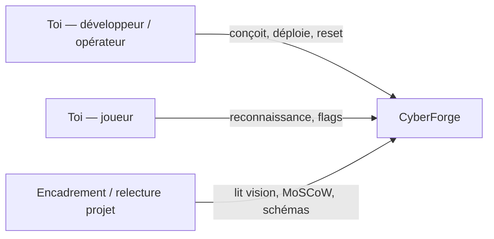

# 01 — Contexte et vision

## 1. Problème

S’entraîner au pentest de façon **reproductible**, **isolée** et **maîtrisée** est difficile :

- les plateformes commerciales (Hack The Box, TryHackMe) sont excellentes, mais le contenu, le scoring et l’infrastructure ne t’appartiennent pas ;
- les CVE récentes arrivent plus vite que les labs publics ;
- un lab “bricolé” sur la machine hôte casse souvent l’isolation et n’est pas rejouable.

CyberForge vise une **plateforme personnelle de cyber-range** : tu choisis (plus tard) une CVE, tu en fais un scénario, tu déploies une box locale, tu la joues, tu valides, tu scores.

## 2. Vision produit

```text
CVE récente
    → Analyse
    → Création d’un scénario
    → Génération d’une box
    → Déploiement isolé
    → Pentest
    → Validation automatique
    → Scoring
```

Box 001 prouve le cœur opérationnel : **déployer → jouer → valider → reset**, sans encore automatiser la recherche de CVE.

## 3. Objectifs

| ID | Objectif | Indicateur |
|----|----------|------------|
| O1 | Disposer d’une box Linux locale jouable de type HTB | `user.txt` et `root.txt` accessibles uniquement avec les privilèges prévus |
| O2 | Rendre le lab reproductible sur Fedora + Podman | `./scripts/deploy.sh` démarre la box sur `127.0.0.1:5000` |
| O3 | Vérifier automatiquement que la box est saine | `validate.sh` retourne `PASS` |
| O4 | Pouvoir réinitialiser l’environnement | `./scripts/reset.sh` reconstruit un état propre |
| O5 | Préparer un format de box extensible vers les CVE | `box.yml` avec `cve: null` aujourd’hui, champ conservé |

## 4. Non-objectifs (cette phase)

- plateforme multi-joueurs / SaaS public ;
- scan ou exploitation vers Internet ;
- génération automatique d’exploits ;
- Kubernetes, Terraform, broker de messages.

## 5. Parties prenantes



| Rôle | Attente |
|------|---------|
| Opérateur | Une commande démarre un lab isolé, une autre le détruit |
| Joueur | Un scénario cohérent, sans flags dans le README public |
| Lecteur projet | Une doc de chefferie : vision, MoSCoW, architecture, risques |

## 6. Contraintes

- **Local uniquement** : bind HTTP `127.0.0.1`, pas de `network_mode: host`
- **Stack hôte** : Fedora, Podman, `podman compose`
- **Box 001** : Python/Flask + Debian, pas d’Angular / Spring / PostgreSQL dans le lab lui-même
- **Éthique** : vulnérabilités volontaires, credentials fictifs, aucune cible tierce

## 7. Hypothèse de valeur

Si le cycle *box → validation → reset* est fiable, alors un back-office (catalogue, scoring, plus tard CVE) peut s’ajouter **sans refondre** le modèle `boxes/<slug>/`.
