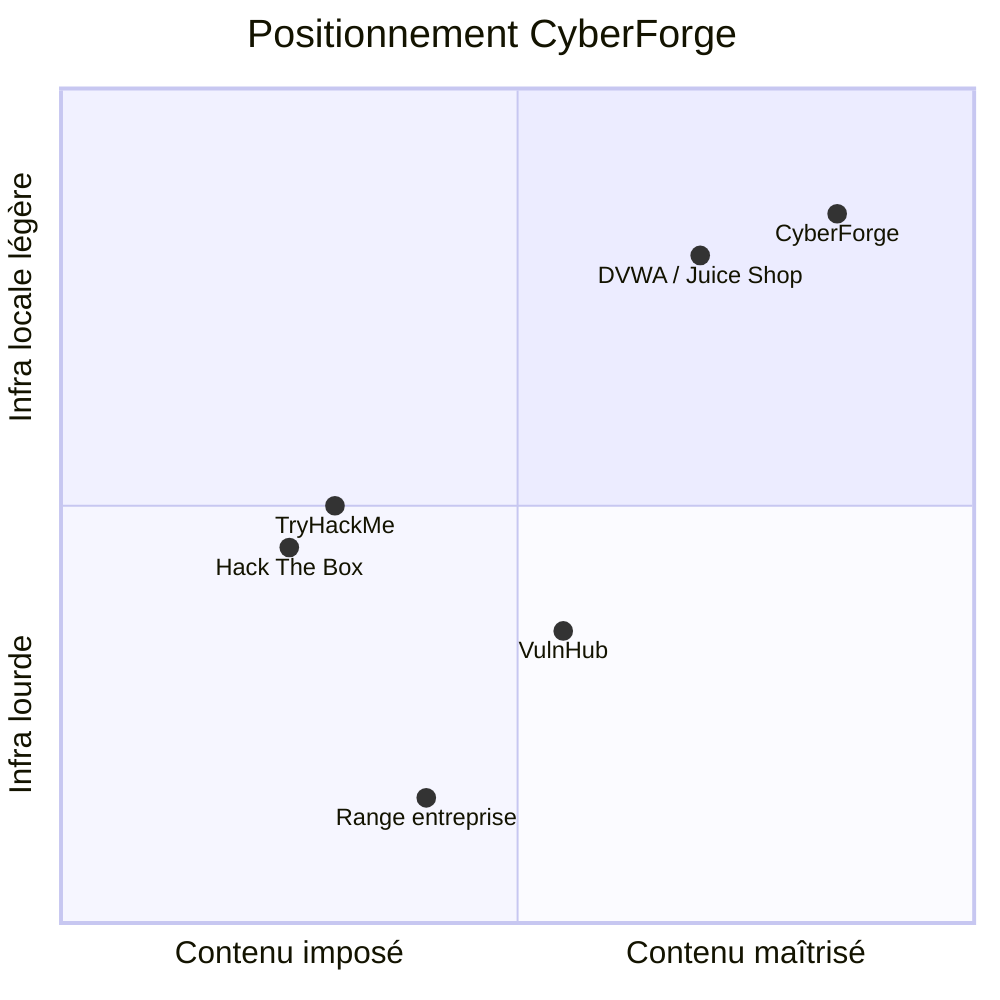

# 02 — État de l’art

Recherche comparative pour positionner CyberForge. Ce n’est pas un audit de ces produits, seulement un cadrage.

## 1. Familles de solutions

| Famille | Exemples | Force | Limite pour ce projet |
|---------|----------|--------|------------------------|
| Plateforme commerciale | Hack The Box, TryHackMe, OffSec PG | Pédagogie, scoring, communauté | Contenu et infra non maîtrisables ; pas conçu pour *ta* CVE du jour |
| Images / VM communautaires | VulnHub, boxes HTB retired | Scénarios riches | Déploiement lourd ; peu d’industrialisation perso |
| Apps volontaires | DVWA, OWASP Juice Shop, WebGoat | Idéal pour une classe de bugs web | Rarement un enchaînement HTB complet (user → root) |
| Ranges entreprise | RangeForce, CyberBit, infra CTF on-prem | Isolation, reporting | Coût, complexité, hors scope personnel |
| Compose local | Labs Docker “vulnerable by design” | Reproductible, git-friendly | Souvent une seule app, pas de pivot interne ni validation opérateur |

## 2. Ce que CyberForge reprend

De HTB / THM :

- machine avec **user flag** puis **root flag** ;
- README public **sans solution** ;
- difficulté déclarée (`easy` pour Box 001).

Des labs Docker :

- **infrastructure as code** (Dockerfile + compose) ;
- reset = rebuild, pas une VM snapshot opaque.

Des ranges pro (en version minimale) :

- réseau **dédié et isolé** ;
- validation automatique de l’environnement (pas du skill du joueur, pour l’instant).

## 3. Écart visé (proposition de valeur)

CyberForge se place sur **contenu maîtrisé + infra locale légère**, avec une trajectoire *CVE → box* que les labs génériques n’offrent pas.

## 4. Travaux / notions de référence

- Cyber ranges et isolation d’environnements d’entraînement
- “Vulnerable by design” (logiciel volontairement imparfait, périmètre déclaré)
- Infrastructure as Code pour labs (Compose/Podman plutôt que K8s au MVP)
- Métadonnées de challenge (`box.yml`) comme contrat d’extensibilité CVE

## 5. Décision issue de la recherche

| Option | Décision | Motif |
|--------|----------|--------|
| VM unique type VulnHub | Écartée au MVP | Plus lourde à resetter, moins git-native |
| Une seule app Flask exposée | Insuffisant | Pas de pivot, trop loin du modèle HTB |
| Deux conteneurs `app` + `target` | **Retenue** | Réaliste, isolable, reproductible |
| Kubernetes | Reporté | Surdimensionné pour un range personnel |
| Récupération auto NVD dès le jour 1 | Reportée | Inutile tant que le cycle box n’est pas stable |
