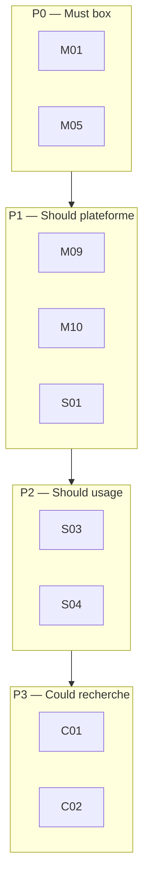

# 03 — Exigences MoSCoW

Priorisation pour la **chefferie de projet**.  
Règle : un **Must** bloqué empêche de déclarer la phase correspondante comme terminée.

Légende des phases :

- **P0** — Box 001 (réalisé)
- **P1** — Plateforme opérateur (back + front)
- **P2** — Multi-boxes et scoring
- **P3** — Pipeline CVE assisté

## 1. Must have

| ID | Exigence | Phase | Statut |
|----|----------|-------|--------|
| M01 | Box Linux locale isolée, jouable en HTTP sur `127.0.0.1` seulement | P0 | Fait |
| M02 | Deux conteneurs minimum (`app`, `target`) sur un réseau dédié | P0 | Fait |
| M03 | Chemin user flag puis root flag, flags non exposés en HTTP | P0 | Fait |
| M04 | Scripts `deploy` / `destroy` / `reset` avec contrôle Podman | P0 | Fait |
| M05 | Validation automatique PASS/FAIL de l’environnement | P0 | Fait |
| M06 | Métadonnées `box.yml` (slug, difficulté, objectifs, `cve`) | P0 | Fait |
| M07 | Documentation publique sans spoiler | P0 | Fait |
| M08 | Aucun scan / exploit vers une cible tierce | P0–P3 | Permanent |
| M09 | API locale pour lister, démarrer, arrêter, reset, valider une box | P1 | À faire |
| M10 | Interface web locale (catalogue + actions opérateur) | P1 | À faire |

## 2. Should have

| ID | Exigence | Phase | Statut |
|----|----------|-------|--------|
| S01 | Stack applicative plateforme : Angular + Spring Boot | P1 | À faire |
| S02 | Persistance (PostgreSQL) : boxes, runs, résultats de validation | P1–P2 | À faire |
| S03 | Soumission des flags et scoring simple (user / root) | P2 | À faire |
| S04 | Support d’au moins deux boxes via le même contrat `boxes/<slug>/` | P2 | À faire |
| S05 | Journal d’un run (démarré, validé, reset, flags) | P2 | À faire |
| S06 | `box.yml` étendu (`cve`, références, objectifs pédagogiques) | P2 | Partiel |

## 3. Could have

| ID | Exigence | Phase | Statut |
|----|----------|-------|--------|
| C01 | Récupération assistée de CVE (NVD / GitHub Advisory) | P3 | Plus tard |
| C02 | Aide à la rédaction de scénario (pas de génération d’exploit) | P3 | Plus tard |
| C03 | Authentification opérateur | P2–P3 | Plus tard |
| C04 | Tableau de bord (historique, taux de réussite) | P3 | Plus tard |
| C05 | File d’attente / jobs async (RabbitMQ ou équivalent) | P3 | Optionnel |
| C06 | Box Windows ou service supplémentaire | P3 | Optionnel |

## 4. Won’t have (hors scope volontaire)

| ID | Exigence | Motif |
|----|----------|--------|
| W01 | Exploitation ou scan d’IP publiques | Éthique et légal |
| W02 | Téléchargement / exécution automatique d’exploits Internet | Hors lab maîtrisé |
| W03 | Kubernetes / Terraform au MVP | Complexité inutile |
| W04 | Plateforme multi-tenant publique | Pas le produit visé |
| W05 | Credentials ou données réelles dans les boxes | Isolation du lab |
| W06 | IA obligatoire dans la chaîne CVE → box | Non nécessaire au besoin |

## 5. Vue MoSCoW par phase

## 6. Critère de go / no-go

| Phase | Go si |
|-------|--------|
| P0 | `validate.sh` → PASS et reset fonctionnel |
| P1 | Un opérateur déploie Box 001 depuis l’UI locale, sans CLI obligatoire |
| P2 | Deux boxes et un score user/root persisté |
| P3 | Une CVE documentée dans `box.yml` relie recherche et lab, sans exploit auto |
