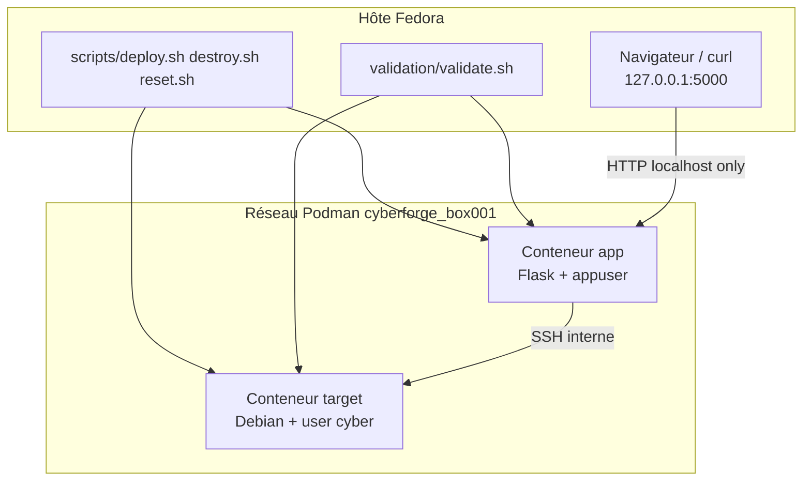
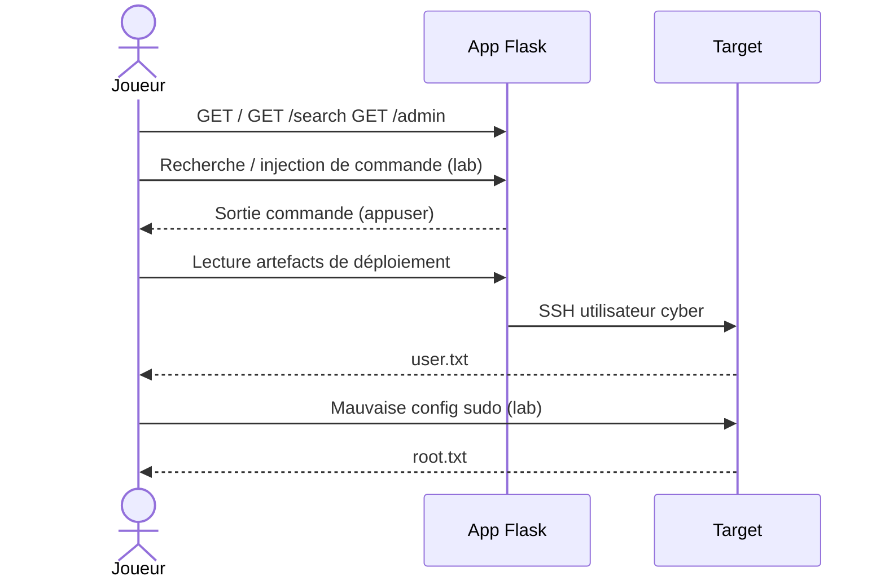
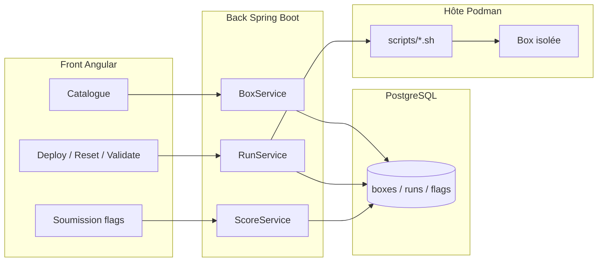
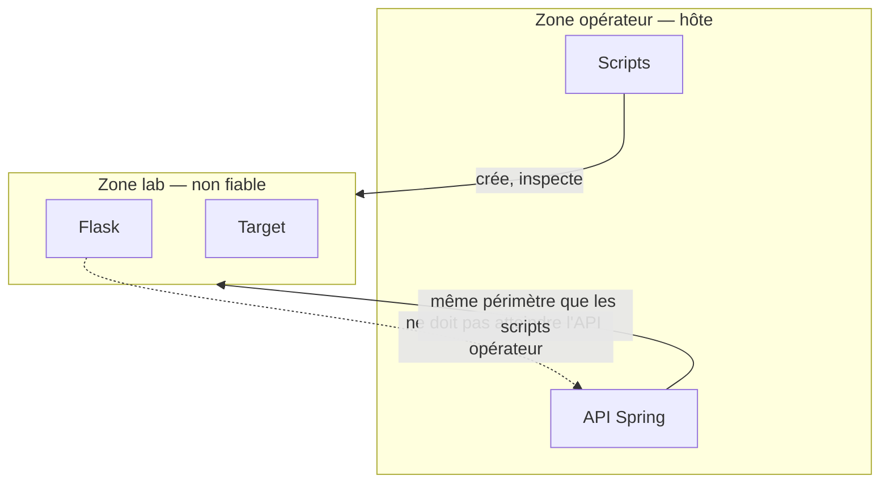

# 04 — Architecture

## 1. Décision structurante

Deux niveaux :

1. **Lab** — ce que le joueur attaque (Box 001 aujourd’hui)
2. **Plateforme** — ce que l’opérateur utilise pour gérer les labs (P1, non implémenté)

Le lab ne dépend pas de la plateforme. La plateforme **orchestre** les scripts déjà existants.

## 2. Architecture actuelle (P0)



Règles :

- le joueur n’atteint **que** HTTP local ;
- `target:22` n’est pas publié sur l’hôte ;
- pas de `network_mode: host`.

## 3. Chemin fonctionnel Box 001



Les détails opérationnels sont dans [`../solution.md`](../solution.md) (spoiler).

## 4. Contrat d’une box

```text
boxes/<slug>/
  box.yml              # métadonnées + validation
  docker-compose.yml
  app/
  target/
  flags/
  validation/
```

`box.yml` est le contrat stable vers P2/P3 (`cve` déjà prévu, valeur `null` en P0).

## 5. Architecture cible (P1–P2)



Le back n’exploite rien : il **démarre**, **observe**, **score**.

## 6. Décisions d’architecture (ADR)

| ID | Décision | Statut | Conséquence |
|----|----------|--------|-------------|
| ADR-01 | Podman Compose plutôt que Kubernetes | Acceptée | Reset simple, fidèle à Fedora |
| ADR-02 | Deux conteneurs par box | Acceptée | Pivot interne réaliste |
| ADR-03 | Bind `127.0.0.1` | Acceptée | Lab non exposé sur le LAN par défaut |
| ADR-04 | Flags générés/stockés dans le dépôt lab | Acceptée P0 | Acceptable en range perso ; à durcir en P2 (secrets de scoring) |
| ADR-05 | Plateforme Angular + Spring + PostgreSQL | Acceptée P1 | Séparation lab / contrôle |
| ADR-06 | Pas d’IA ni d’exploit auto dans la chaîne | Acceptée | Recherche CVE ≠ génération d’arme |

## 7. Frontière de confiance



L’application Flask de Box 001 ne doit jamais devenir le backend de la plateforme.
