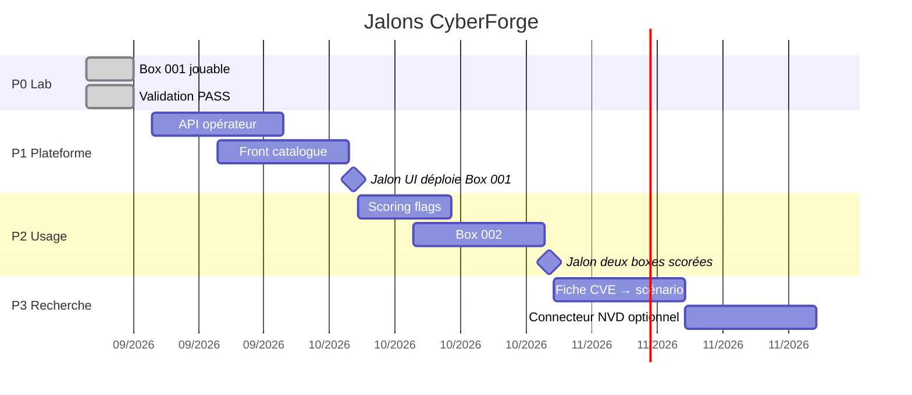

# 05 — Organisation et planning

## 1. WBS

```mermaid
flowchart TB
  CF[CyberForge]
  CF --> A[A. Lab Box 001]
  CF --> B[B. Plateforme]
  CF --> C[C. Usage et scoring]
  CF --> D[D. Recherche CVE]
  CF --> E[E. Chefferie et qualité]

  A --> A1[A1. App volontaire]
  A --> A2[A2. Target + flags]
  A --> A3[A3. Compose / réseau]
  A --> A4[A4. Scripts et validation]

  B --> B1[B1. API boxes / runs]
  B --> B2[B2. Front catalogue]
  B --> B3[B3. Pont vers scripts Podman]

  C --> C1[C1. Multi-boxes]
  C --> C2[C2. Soumission flags]
  C --> C3[C3. Historique]

  D --> D1[D1. Veille CVE manuelle]
  D --> D2[D2. Fiche scénario]
  D --> D3[D3. Connecteurs NVD optionnels]

  E --> E1[E1. Docs vision / MoSCoW]
  E --> E2[E2. ADR et schémas]
  E --> E3[E3. Risques et éthique]
```

## 2. Phases et jalons

Les dates P1+ sont **planifiées**, pas engagées contractuellement. Les ajuster au rythme réel.

## 3. Livrables par phase

| Phase | Livrable | Preuve |
|-------|----------|--------|
| P0 | Box 001 + scripts + `validate.sh` | `Box validation: PASS` |
| P0 | Doc projet (ce dossier) | Schémas + MoSCoW relus |
| P1 | API + UI locale | Déployer Box 001 sans CLI obligatoire |
| P2 | Scoring + 2e box | Flags persistés, reset indépendant |
| P3 | Traçabilité CVE dans `box.yml` | Une box avec `cve:` renseigné, sans exploit auto |

## 4. Rôles (même si le projet est solo)

| Rôle | Responsabilité | En solo |
|------|----------------|---------|
| Product owner | MoSCoW, go/no-go de phase | Toi |
| Architecte | ADR, frontières lab / plateforme | Toi |
| Réalisateur lab | Dockerfiles, scénario, flags | Toi |
| Réalisateur plateforme | Angular / Spring | Toi, à partir de P1 |
| RSSI de lab | Isolation, Won’t have éthiques | Toi, non négociable |

Un projet solo reste gérable si **les phases ne se mélangent pas** : on n’ouvre pas NVD pendant que l’UI de deploy n’existe pas.

## 5. Backlog immédiat (après cette doc)

1. Spec API P1 (ressources `Box`, `Run`, `Validation`)
2. Choix PostgreSQL local vs volume Podman pour la plateforme
3. Maquette Angular : liste + 4 actions (deploy, destroy, reset, validate)
4. Box 002 seulement après le jalon M1

## 6. Suivi

Proposition de statut hebdomadaire (même 10 minutes) :

| Semaine | Phase | Fait | Bloquant | Décision |
|---------|-------|------|----------|----------|
| S0 | P0 | Box 001 + push GitHub | — | Doc chefferie |
| S1 | P1 | | | |

À remplir au fil de l’eau, sans outil obligatoire (ce tableau dans un commit suffit).
