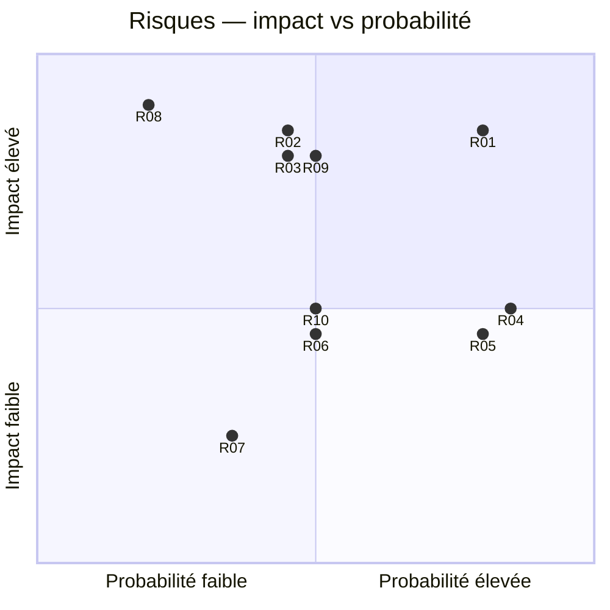

# 06 — Risques et sécurité

## 1. Matrice de risques projet

Probabilité et impact : F = faible, M = moyen, E = élevé.

| ID | Risque | P | I | Mitigation | Owner |
|----|--------|---|---|------------|--------|
| R01 | Scope creep (CVE auto, K8s, IA) avant un lab stable | E | E | MoSCoW + jalons go/no-go | PO |
| R02 | Lab joignable hors localhost | M | E | Bind `127.0.0.1`, test dans `validate.sh` | RSSI lab |
| R03 | Confusion lab / machine hôte | M | E | Jamais `network_mode: host` ; réseau dédié | Architecte |
| R04 | Flags et clés de lab dans Git | E | M | Accepté en P0 range perso ; scoring séparé en P2 | Architecte |
| R05 | Podman socket inactif sur Fedora | E | M | Scripts démarrent `podman.socket` | Réalisateur |
| R06 | Reset incomplet après privesc | M | M | `reset.sh` rebuild ; validation post-reset | Réalisateur |
| R07 | Doc publique qui spoil le challenge | M | F | Solution isolée, README box sans walkthrough | PO |
| R08 | Dérive éthique (scan externe, exploits téléchargés) | F | E | Won’t have W01–W02, revue de chaque box | RSSI lab |
| R09 | Plateforme trop tôt, lab pas rejouable | M | E | P1 interdit tant que P0 n’est pas vert | PO |
| R10 | Une seule box = modèle `box.yml` non prouvé | M | M | Box 002 en P2 | PO |

## 2. Règles de sécurité du lab (permanentes)

- environnement **strictement local** ;
- pas de scan Internet, pas d’IP publique comme cible ;
- pas de credentials réels ;
- vulnérabilité **volontaire et documentée en interne** seulement ;
- le processus web de Box 001 ne tourne pas en root ;
- `root.txt` n’est lisible que par root.

## 3. Risques pédagogiques

| Risque | Traitement |
|--------|------------|
| Le joueur lit `flags/` dans Git | Prévenir dans le README ; acceptable en range perso |
| Injection trop opaque | `/search` affiche la sortie — lab pédagogique, pas un 0-day |
| Privesc trop “CTF dirty” | Sudo + script world-writable, reproductible, limité au lab |

## 4. Conformité au Won’t have

Toute issue ou PR qui introduit :

- un client NVD **exécutant** un PoC,
- un bind `0.0.0.0` sans décision ADR,
- un secret réel,

est **refusée** jusqu’à revue explicite.

## 5. Revue

À chaque fin de phase : relire ce fichier, clôturer les risques devenus nuls, en ajouter si la plateforme expose une API.
